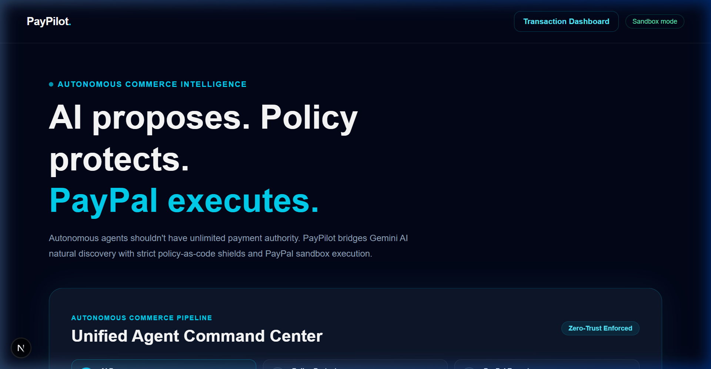
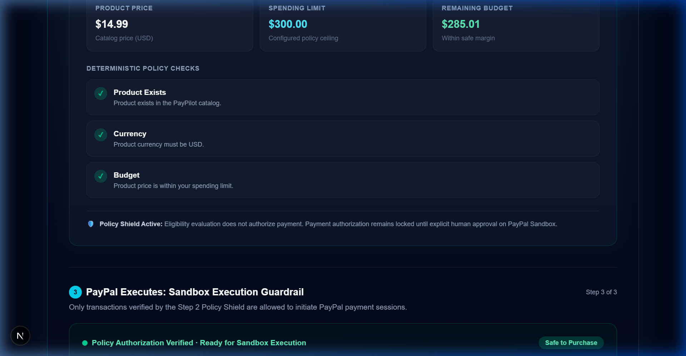
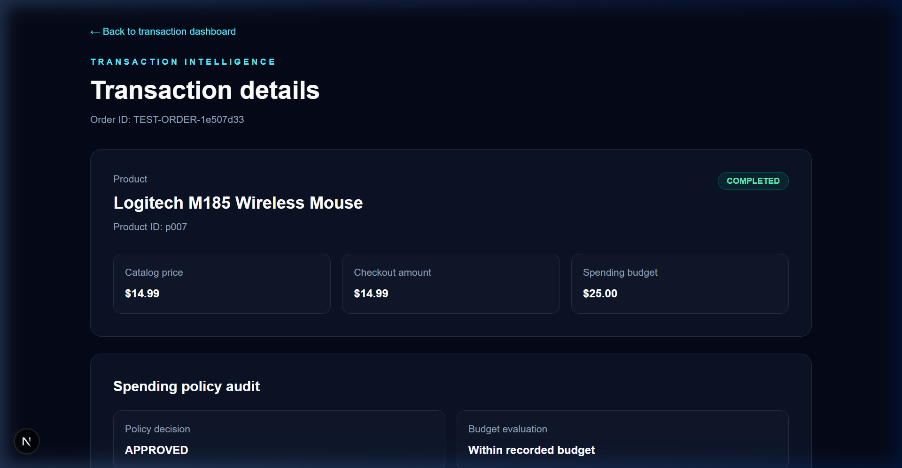
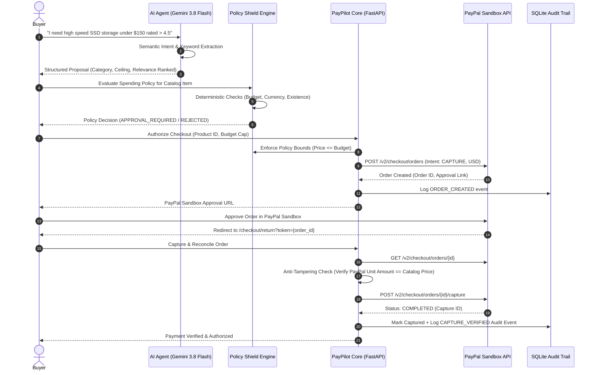

# PayPilot
> **"AI proposes. Policy protects. PayPal executes."**

[](https://developer.paypal.com)
[](https://nextjs.org)
[](https://fastapi.tiangolo.com)
[](https://ai.google.dev)
[](https://www.typescriptlang.org)
[](https://sqlite.org)

PayPilot is an **AI-powered autonomous commerce platform** designed to solve the single largest bottleneck in agentic shopping: 

**The Trust & Liability Problem**. 

While modern LLMs can discover products, giving an autonomous agent unrestricted access to financial instruments invites catastrophic risk from hallucinations, prompt injections, and price tampering. PayPilot places an ironclad **Policy-as-Code Shield** between the AI agent and the **PayPal execution network**.

---

## 📸 Interface & Live Workflow

### 1. Unified 3-Step Commerce Pipeline Command Center
*Seamlessly connects Gemini AI Natural Language Discovery with real-time budget telemetry and PayPal execution gating.*



---

### 2. Policy-as-Code Shield & PayPal Execution Guardrail
*Deterministic policy checks ensure no unauthorized order can be created or captured without meeting exact spending rules.*



---

### 3. Cryptographic Audit Trail & State Timeline
*Every order creation, policy decision, and capture verification is logged with immutable timestamped JSON metadata.*



---

## Architecture & Workflow



---

## 🎯 Key Features

### 1. 🧠 Hybrid AI Commerce Agent
- **Powered by Google Gemini 3.8 Flash**: Interprets natural language shopping prompts (e.g. *"compact mechanical keyboard below 100"* or *"noise-cancelling headphones for travel"*).
- **Semantic Feature & Relevance Scoring**: Dynamically ranks catalog candidates by feature keyword relevance (`wired`, `wireless`, `mechanical`, `compact`), customer satisfaction rating, and price.
- **Fail-Safe Resilience**: If no API key is present or network connectivity drops, the system gracefully falls back to the deterministic **PayPilot Autonomous Rules Engine** without breaking or throwing runtime errors.

### 2. 🛡️ Deterministic Spending Policy Engine
- **Policy-as-Code**: Enforces hard spending ceilings, product existence verification, and strict USD currency compliance using exact financial decimal arithmetic (`ROUND_HALF_UP`).
- **Policy Shield Guarantees**: Policy eligibility *never* equals payment authorization. Authorization remains locked until explicit human-in-the-loop approval.
- **Explainable Decisions**: Transparent visual breakdown showing product price, spending limit, and remaining budget deficit/surplus.

### 3. 💳 PayPal Sandbox Orders v2 Execution
- **Server-Side Integration**: Built on PayPal REST API v2 (`/v2/checkout/orders`).
- **Tamper-Proof Capture**: Before capturing funds, the backend independently queries PayPal to ensure the buyer-approved charge matches the native catalog price, preventing client-side price modification attacks.
- **Idempotent State Management**: Complete idempotency on order creation and capture updates (`ON CONFLICT(paypal_order_id) DO UPDATE`), preventing duplicate charges.

### 4. 📜 Cryptographic Audit Trail & Financial Dashboard
- **Immutable Timeline**: Every state transition (`ORDER_CREATED`, `CAPTURE_VERIFIED`) is recorded with timestamped JSON metadata.
- **Transaction Intelligence**: Live metrics tracking verified catalog spend, completed captures, pending orders, and policy-approved records.

---

## 🔒 Security & Threat Model

| Threat Vector | Risk Description | PayPilot Defense Mechanism |
| :--- | :--- | :--- |
| **Prompt Injection** | Rogue vendor prompts manipulate agent into overpaying. | **Policy Shield Sandbox**: The LLM *only* proposes; hard-coded deterministic policy rules enforce price boundaries regardless of LLM output. |
| **Price Tampering** | Malicious client alters DOM price before checkout. | **Catalog Reconciliation**: Backend re-validates catalog price from trusted backend data, rejecting mismatches with HTTP 409/400. |
| **Currency Arbitrage** | Cross-border currency conversion rate attacks. | **Strict Currency Locking**: Catalog and PayPal purchase units are strictly enforced as native `USD`. |
| **Duplicate Captures** | Network retries triggering double-charging. | **Idempotent SQLite Architecture**: SQLite database uses unique constraints on `paypal_order_id` with atomic status updates. |

---

## 🔌 PayPal APIs Utilized

| Endpoint | Method | Purpose |
| :--- | :--- | :--- |
| `/v1/oauth2/token` | `POST` | Fetches OAuth2 Bearer Access Token using PayPal Client Credentials. |
| `/v2/checkout/orders` | `POST` | Creates an order with `intent: CAPTURE`, purchase units, and return/cancel application contexts. |
| `/v2/checkout/orders/{id}` | `GET` | Server-side validation of order status, purchase unit amounts, and currency code. |
| `/v2/checkout/orders/{id}/capture` | `POST` | Captures authorized funds once buyer approval is verified on PayPal Sandbox. |

---

## 🛠️ Tech Stack

- **Frontend**: Next.js 16 (Turbopack, App Router), TypeScript, Vanilla CSS & Tailwind CSS (Dark Glassmorphic Theme).
- **Backend**: FastAPI, Pydantic v2, HTTPX, Python-dotenv, SQLite3.
- **AI Engine**: Google Gemini 3.8 Flash (`gemini-3.8-flash` via Google GenAI REST) with fallback to deterministic semantic rule parsing.
- **Payments**: PayPal Developer Sandbox (Orders v2 API & OAuth2).

---

## 🚀 Quickstart & Setup

### Prerequisites
- Node.js 18+ & npm
- Python 3.11+
- PayPal Developer Account (Sandbox Client ID & Secret)

### 1. Clone Repository
```bash
git clone https://github.com/Yeshwanth-develops/PayPilot.git
cd PayPilot
```

### 2. Backend Setup
```bash
cd backend
python -m venv .venv
source .venv/bin/activate  # On Windows: .venv\Scripts\activate
pip install -r requirements.txt  # or: pip install fastapi uvicorn httpx python-dotenv pydantic

# Configure environment variables
cp .env.example .env
```

Edit `backend/.env`:
```env
FRONTEND_ORIGIN=http://localhost:3000
PAYPAL_CLIENT_ID=your_paypal_sandbox_client_id
PAYPAL_CLIENT_SECRET=your_paypal_sandbox_client_secret
PAYPAL_BASE_URL=https://api-m.sandbox.paypal.com

# Optional (for live LLM reasoning):
GEMINI_API_KEY=your_gemini_api_key
```

Run the backend server:
```bash
uvicorn main:app --reload --port 8000
```

### 3. Frontend Setup
```bash
cd ../frontend
npm install

# Configure environment variables
cp .env.example .env.local
```

Run the frontend dev server:
```bash
npm run dev
```

Open [http://localhost:3000](http://localhost:3000) in your browser.

---

## 🔮 Future Roadmap

- [ ] **PayPal Webhook Automation**: Direct asynchronous webhook handlers (`CHECKOUT.ORDER.APPROVED`) for headless agent checkout.
- [ ] **Programmable Agent Allowances**: Recurring PayPal subscriptions granting AI agents monthly autonomous micro-budgets.
- [ ] **Multi-Merchant Price Negotiation**: Multi-agent bidding where merchant agents compete for the user's policy-approved basket.

---

## 📄 License
This project is open-source under the [MIT License](LICENSE).
